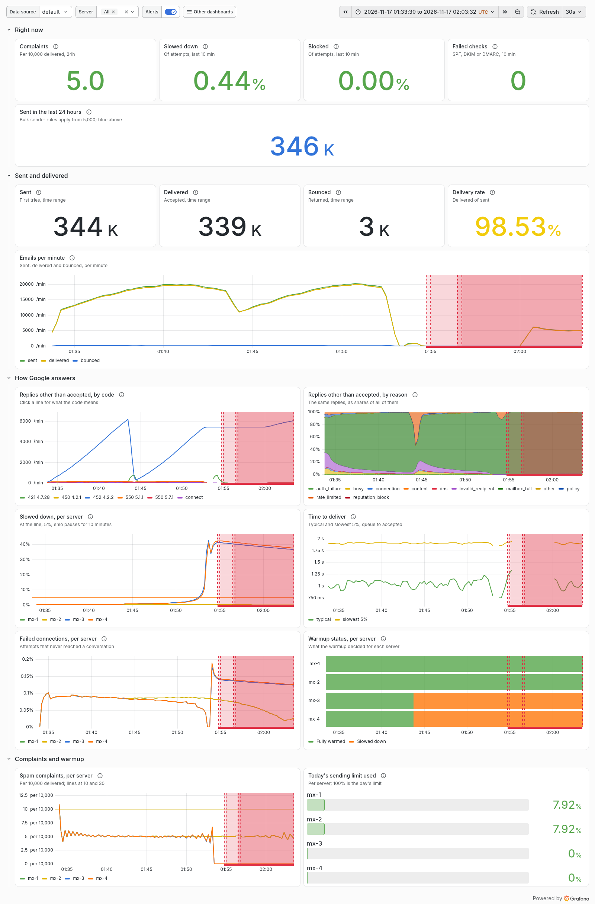

# ehlo

[](https://github.com/cauebraz/ehlo/actions/workflows/ci.yml)
[](https://scorecard.dev/viewer/?uri=github.com/cauebraz/ehlo)
[](https://pkg.go.dev/github.com/cauebraz/ehlo)
[](LICENSE)

ehlo watches how Gmail, Microsoft, Yahoo and other mailbox providers answer your mail servers, and tells you how much each server can send to each provider today.

<picture>
  <source media="(prefers-color-scheme: dark)" srcset="docs/images/dashboards/ehlo-gmail-dark.png">
  
</picture>

The Gmail dashboard while Gmail rate limits two of four servers. [All nine dashboards](docs/dashboards.md).

## The problem

Mailbox providers judge each sending IP by its history. An IP that sends 100,000 messages to Gmail on its first day gets `421 4.7.28` rate limit replies, then blocks. An IP that already has a reputation loses it when complaints pass 0.3%. The signals arrive as SMTP reply codes that differ per provider (`4.7.28`, `TSS04`, `S3150`), spread across MTA logs and ESP webhooks.

## What ehlo does

```
Postfix, KumoMTA, PowerMTA,      events      +------+   /metrics    Prometheus, Grafana:
SES, SendGrid, your code    ---------------> | ehlo | ------------> 9 dashboards, 17 alerts
                                             |      |
your sending code           <--------------- |      |
(picks a server per batch)   GET /v1/limits  +------+
```

1. It reads delivery events: attempts, SMTP replies, bounces, complaints, queue sizes, DMARC rows. Adapters cover Postfix logs, KumoMTA, PowerMTA, SES and SendGrid; anything else posts JSON.
2. It sorts each reply into a category such as `rate_limited`, `reputation_block` or `auth_failure`, and exports Prometheus metrics, recording rules, alerts and Grafana dashboards.
3. It keeps a warmup limit per server and provider, called a lane. A new lane starts at 50 messages a day and grows after each day that used 70% of its limit and stayed under the complaint and bounce thresholds. It holds when complaints or bounces cross them, and stops for 10 minutes when the provider rate limits it.
4. It answers `GET /v1/limits/{server}/{provider}` with how many messages that lane may send now.

ehlo does not send or hold mail. The code that decides which server sends a batch asks ehlo first and stays within the answer. Without that step, ehlo still gives the metrics, dashboards and alerts.

## Ask before sending

Two servers toward Gmail. `mx-1` already has a reputation (listed under `targets.warm`), `mx-5` is a new IP. The config sets a daily target of 200,000 per server and gives Gmail 55% of it:

```
$ curl -s localhost:8080/v1/limits/mx-1/gmail
{"source":"mx-1","provider":"gmail","state":"at_target","reason":"configured warm",
 "allowed_now":103978,"limit":110000,"sent":6022,"target":110000,"engaged_only":false,...}

$ curl -s localhost:8080/v1/limits/mx-5/gmail
{"source":"mx-5","provider":"gmail","state":"raising","reason":"new lane",
 "allowed_now":0.125,"limit":50,"sent":3,"hourly_limit":3.125,"target":110000,"engaged_only":true,...}
```

| Field | `mx-1` | `mx-5` |
|-------|--------|--------|
| `target` | 110,000: 200,000 x 0.55 for Gmail | Same target |
| `limit` | Already at the target | 50 on its first day; it grows x1.5 per clean day toward Gmail |
| `sent` | 6,022 first attempts today | 3 |
| `allowed_now` | 103,978 more today | 0 now: below its target a lane may send `limit / 16` per hour, 3.125, and it sent 3 this hour |
| `engaged_only` | false | true: send only to recipients who opened or clicked recently |

The sender routes this batch's Gmail mail through `mx-1` and asks again for the next batch. When a lane has nothing left, `next_hour_at`, `day_end` or `resume_at` says when to ask again. [Limits](docs/limits.md) has every field, rule and config key.

## Who it is for

Teams that run their own mail servers (Postfix or another MTA) or send through SES or SendGrid, and need to:

- warm up new sending IPs without tripping Gmail, Microsoft or Yahoo limits,
- see when a provider rate limits, blocks or defers their mail, and why,
- alert on complaint and bounce ratios before a provider acts on them.

## Try it in five minutes

Requires Docker with Compose v2, [just](https://github.com/casey/just) and `openssl` (used once to create a Grafana password).

```
git clone https://github.com/cauebraz/ehlo.git && cd ehlo
just up                        # ehlo, simulator, Prometheus and Grafana; waits until healthy
open http://localhost:3000     # Grafana, read-only without login; opens on the Overview dashboard
just scenario gmail-throttle   # Gmail, Yahoo and Microsoft rate limit two servers
curl -s 'localhost:8080/v1/limits?provider=gmail'
just reset                     # delete the data and go back to the steady scenario
```

The simulator plays four servers and routes its traffic by `allowed_now`, as a sender would. The demo listens on `127.0.0.1` only: ehlo on 8080, Prometheus on 9090, Grafana on 3000. A warmup day lasts 24 minutes. [Setup](docs/setup.md#demo) lists the scenarios.

## Run it

| Where | Start with |
|-------|------------|
| A Linux host | [Setup](docs/setup.md): install, configure, then [connect your MTA or ESP](docs/integrations.md) |
| Kubernetes | [Kubernetes](docs/kubernetes.md): the Helm chart, with a ServiceMonitor, PrometheusRule and dashboards for kube-prometheus-stack |
| An existing Prometheus and Grafana | [Monitoring](docs/monitoring.md): `ehlo-monitoring render` writes the rules and dashboards for your job name, labels and datasource |

```
helm install ehlo oci://ghcr.io/cauebraz/charts/ehlo --version <version> \
  --namespace ehlo --create-namespace \
  --set serviceMonitor.enabled=true --set serviceMonitor.labels.release=<kube-prometheus-stack release> \
  --set prometheusRule.enabled=true --set prometheusRule.labels.release=<kube-prometheus-stack release> \
  --set dashboards.enabled=true
```

Run one ehlo process per warmup state: each process counts its own sends, so two replicas would split the counts ([why](docs/monitoring.md#one-replica)).

## Requirements

| Component | Version |
|-----------|---------|
| Go, to build from source | 1.27 or later |
| Prometheus, for the rules and alerts | 3.x; CI tests them with 3.16 |
| Grafana, to import the dashboards | 13 or later. The dashboards use the Grafana dashboard schema v2, which older versions cannot import. Releases also attach classic copies, tested on 12.4 |
| Kubernetes, for the Helm chart | 1.30 or later; CI tests the chart with Helm 4.3.2 |
| Grafana Operator, for `GrafanaManifest` objects | v5.25 or later |

Releases ship Linux and macOS binaries for amd64 and arm64, `ehlo-monitoring` for Linux, macOS and Windows, the image `ghcr.io/cauebraz/ehlo` for linux/amd64 and linux/arm64, and the Helm chart `oci://ghcr.io/cauebraz/charts/ehlo`. Each release has SBOMs, a checksum file and GitHub build provenance attestations; [Setup](docs/setup.md#install) shows how to verify them.

## Docs

Read in this order to deploy:

1. [Setup](docs/setup.md): install, configure, send events, monitor
2. [Integrations](docs/integrations.md): feed ehlo from Postfix, KumoMTA, PowerMTA, SES, SendGrid or any MTA
3. [Limits](docs/limits.md): lanes, warmup rules, the limits API and every config key

Then, as needed:

- [Kubernetes](docs/kubernetes.md): Helm chart, kube-prometheus-stack, Grafana Operator, Mimir
- [Monitoring](docs/monitoring.md): render rules and dashboards for your stack
- [Dashboards](docs/dashboards.md): what each dashboard shows, with screenshots
- [Alerts](docs/alerts.md): what each alert means and what to do
- [Events](docs/events.md): event format and adapter mappings
- [Metrics](docs/metrics.md): metrics and reply categories
- [Changelog](CHANGELOG.md), [Contributing](CONTRIBUTING.md), [Code of Conduct](CODE_OF_CONDUCT.md), [Security](SECURITY.md)

## Status

Pre-1.0: event fields, metric names and config keys may change between minor releases. [CHANGELOG.md](CHANGELOG.md) lists each change.

## License

[MIT](LICENSE)
