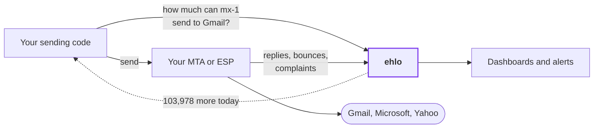

# ehlo

[](https://github.com/cauebraz/ehlo/actions/workflows/ci.yml)
[](https://scorecard.dev/viewer/?uri=github.com/cauebraz/ehlo)
[](https://pkg.go.dev/github.com/cauebraz/ehlo)
[](LICENSE)

**Warm up new sending IPs without getting blocked by Gmail, Microsoft or Yahoo.**

ehlo watches how mailbox providers answer your mail servers and tells each server how much it can send to each provider today.

<picture>
  <source media="(prefers-color-scheme: dark)" srcset="docs/images/dashboards/ehlo-gmail-dark.png">
  
</picture>

## Why

A new IP that sends 100,000 messages to Gmail on its first day gets rate limited, then blocked. An IP with a good reputation loses it when complaints pass 0.3%. The warning signs are there, but as SMTP codes that differ per provider (`4.7.28`, `TSS04`, `S3150`), spread across MTA logs and ESP webhooks.

## What you get

- **A safe daily limit per server and provider.** A new IP starts at 50 messages a day and grows after each clean day. The limit holds when complaints or bounces rise, and pauses when the provider rate limits.
- **The reason behind each deferral and block**, in plain categories such as `rate_limited`, `reputation_block` and `auth_failure`.
- **Nine Grafana dashboards and 18 Prometheus alerts**, ready to import.

It reads Postfix logs, KumoMTA, PowerMTA, Amazon SES and SendGrid; any other MTA posts JSON.

## How it works



Before each batch, your sending code asks ehlo and stays within the answer:

```
$ curl -s localhost:8080/v1/limits/mx-1/gmail
{"source":"mx-1","provider":"gmail","state":"at_target","allowed_now":103978,"limit":110000,"sent":6022,...}
```

`mx-1` may send 103,978 more messages to Gmail today. ehlo never sends or holds mail itself, and without this step you still get the dashboards and alerts. [Limits](docs/limits.md) explains every field and rule.

## Try it in five minutes

Requires Docker with Compose v2, [just](https://github.com/casey/just) and `openssl`.

```
git clone https://github.com/cauebraz/ehlo.git && cd ehlo
just up                        # ehlo, a traffic simulator, Prometheus and Grafana
open http://localhost:3000     # Grafana, opens on the Overview dashboard
just scenario gmail-throttle   # Gmail, Yahoo and Microsoft rate limit two servers
just reset                     # back to the start
```

## Install

- **Linux host:** [Setup](docs/setup.md), then [connect your MTA or ESP](docs/integrations.md).
- **Kubernetes:** `helm install ehlo oci://ghcr.io/cauebraz/charts/ehlo --version <version>`; [Kubernetes](docs/kubernetes.md) covers kube-prometheus-stack.
- **Existing Prometheus and Grafana:** [Monitoring](docs/monitoring.md) renders the rules and dashboards for your labels.

## Docs

[Setup](docs/setup.md) - [Integrations](docs/integrations.md) - [Limits](docs/limits.md) - [Kubernetes](docs/kubernetes.md) - [Monitoring](docs/monitoring.md) - [Dashboards](docs/dashboards.md) - [Alerts](docs/alerts.md) - [Events](docs/events.md) - [Metrics](docs/metrics.md) - [Changelog](CHANGELOG.md) - [Contributing](CONTRIBUTING.md) - [Code of Conduct](CODE_OF_CONDUCT.md) - [Security](SECURITY.md)

Pre-1.0: event fields, metric names and config keys may change between minor releases. [MIT](LICENSE) license.
