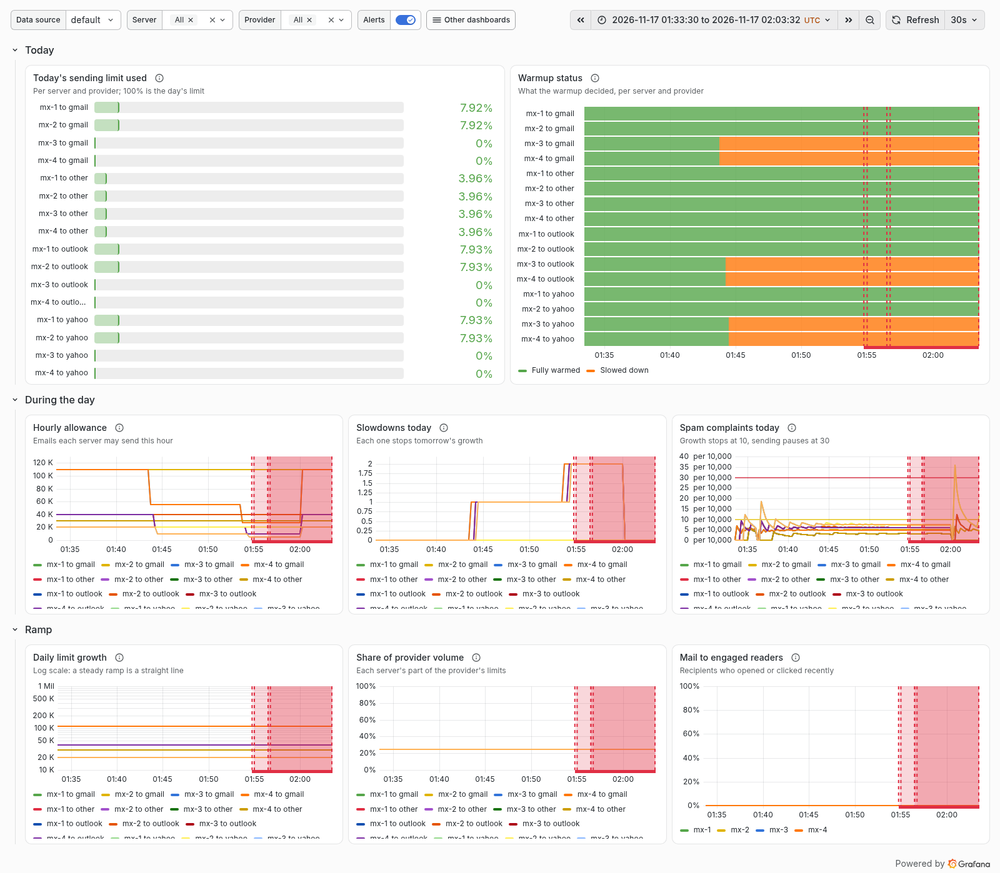
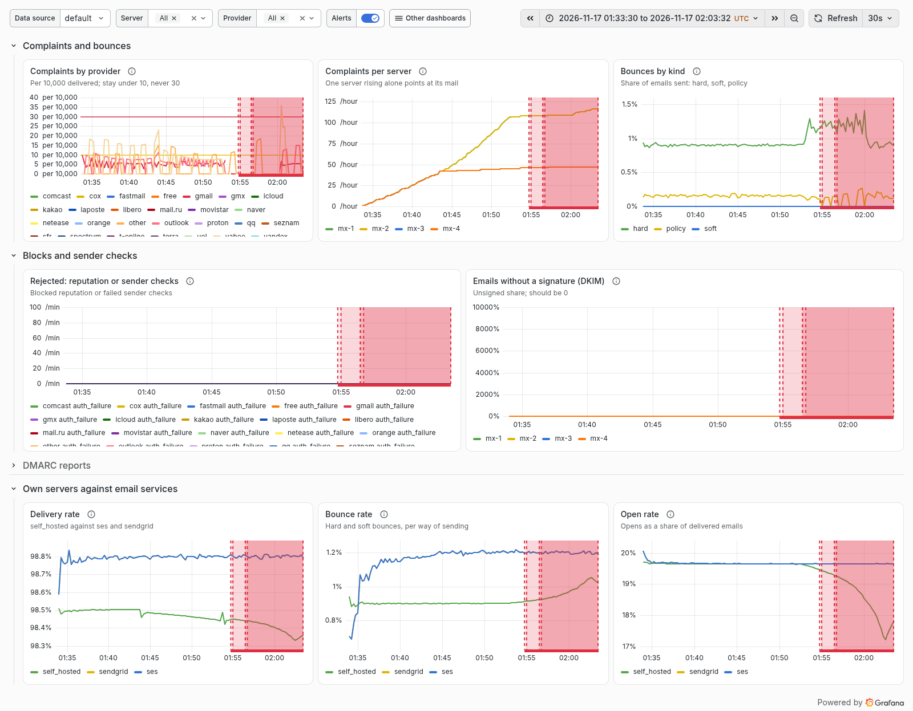
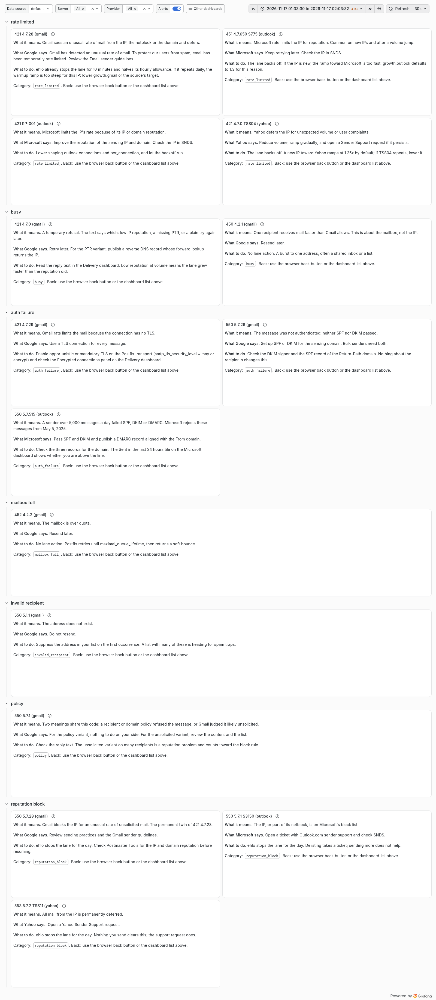

# Dashboards

Screenshots of the nine dashboards from the demo stack: four servers on the `steady` scenario for 10 minutes, then `gmail-throttle` for 20 minutes, where Gmail, Yahoo and Microsoft rate limit `mx-3` and `mx-4`. The simulator sends 300,000 messages a day instead of the demo's 600,000, so `mx-1` and `mx-2` take the traffic the slowed servers cannot send without reaching their daily limit inside the window. [setup.md](setup.md#monitor) describes what each dashboard shows, and [alerts.md](alerts.md) explains each alert.

`just screenshots` regenerates every image in `docs/images/dashboards`, in light and dark. It starts a throwaway copy of the stack under the Compose project `ehlo-screenshots`, so a running `just up` keeps its ports and data, renders with the Grafana image renderer, then removes the copy and its volumes. A run takes about 35 minutes. `just screenshots complaint-spike` uses another scenario for the last 20 minutes. Run it after a change to `monitoring/` that alters what a dashboard looks like.

## Overview

<picture>
  <source media="(prefers-color-scheme: dark)" srcset="images/dashboards/ehlo-overview-dark.png">
  
</picture>

## Warmup

<picture>
  <source media="(prefers-color-scheme: dark)" srcset="images/dashboards/ehlo-warmup-dark.png">
  
</picture>

## Delivery

<picture>
  <source media="(prefers-color-scheme: dark)" srcset="images/dashboards/ehlo-delivery-dark.png">
  
</picture>

## Reputation

<picture>
  <source media="(prefers-color-scheme: dark)" srcset="images/dashboards/ehlo-reputation-dark.png">
  
</picture>

## Pipeline

<picture>
  <source media="(prefers-color-scheme: dark)" srcset="images/dashboards/ehlo-pipeline-dark.png">
  
</picture>

## Gmail

<picture>
  <source media="(prefers-color-scheme: dark)" srcset="images/dashboards/ehlo-gmail-dark.png">
  
</picture>

## Microsoft

<picture>
  <source media="(prefers-color-scheme: dark)" srcset="images/dashboards/ehlo-microsoft-dark.png">
  
</picture>

## Yahoo

<picture>
  <source media="(prefers-color-scheme: dark)" srcset="images/dashboards/ehlo-yahoo-dark.png">
  
</picture>

## Reply codes

<picture>
  <source media="(prefers-color-scheme: dark)" srcset="images/dashboards/ehlo-codes-dark.png">
  
</picture>
