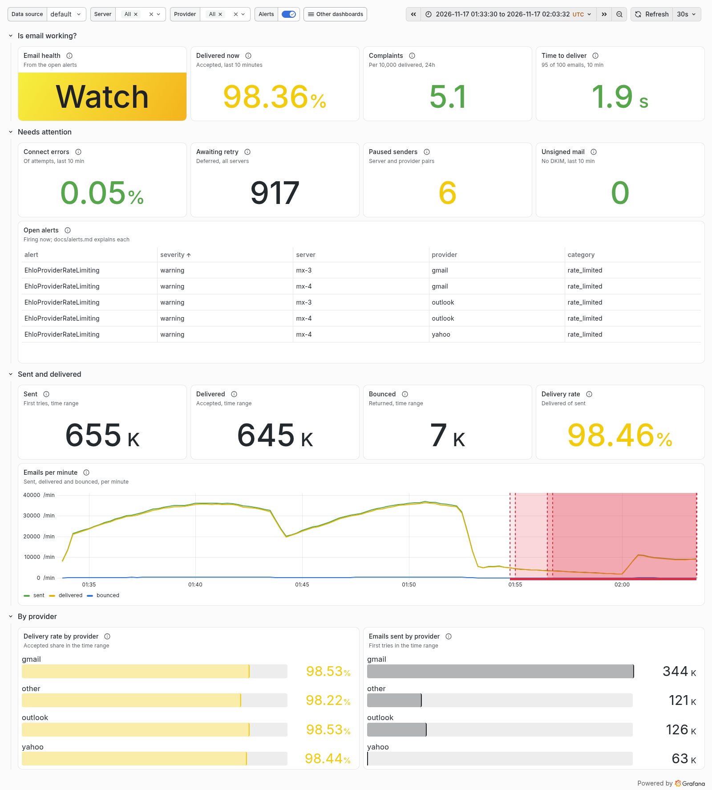
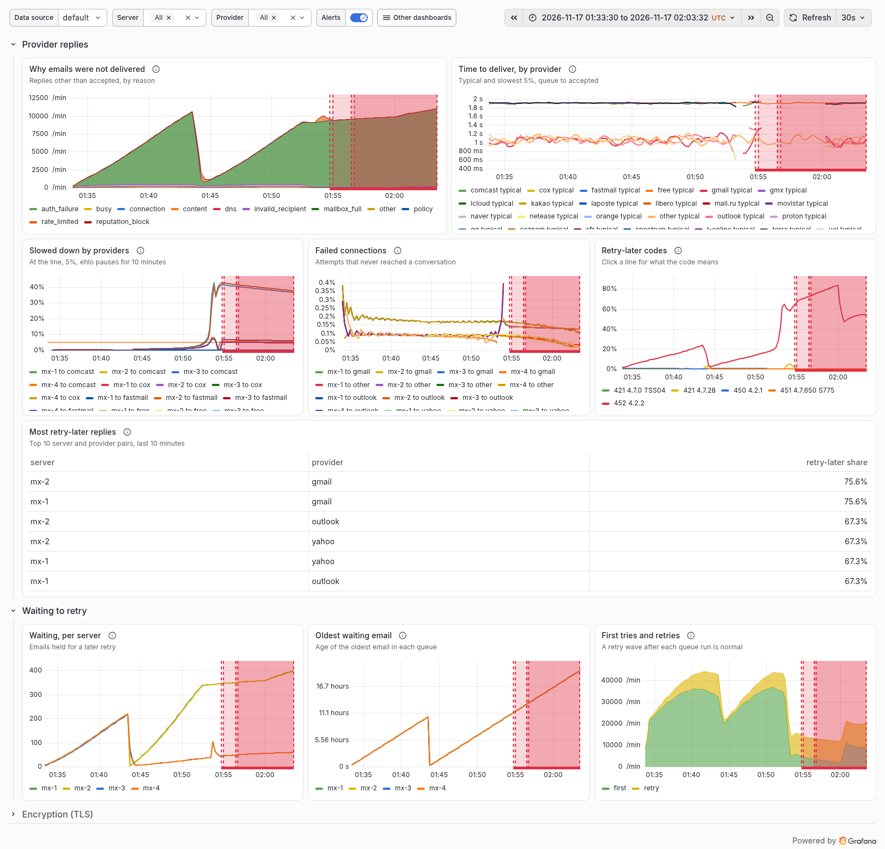
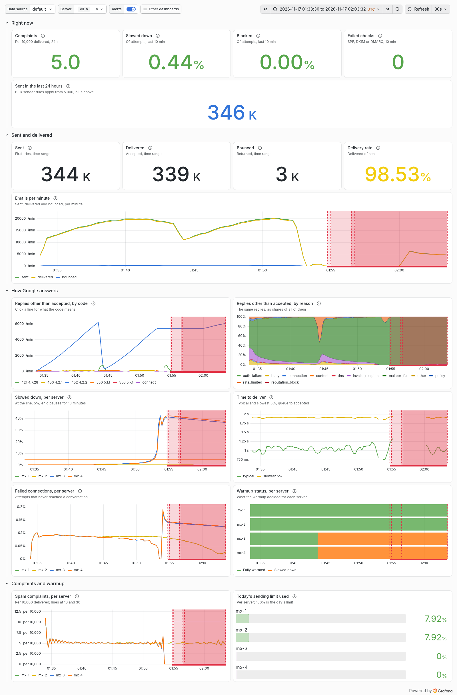
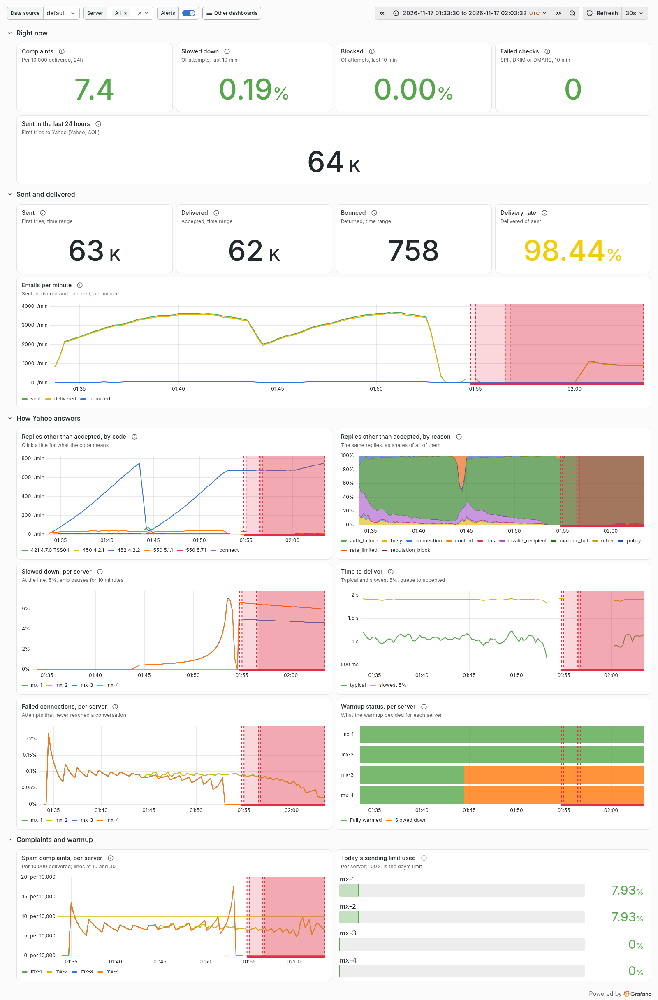
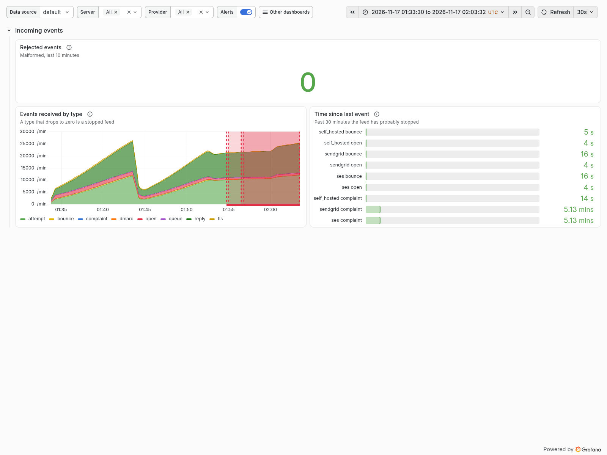

# Dashboards

Screenshots of the nine dashboards from the demo stack: four servers on the `steady` scenario for 10 minutes, then `gmail-throttle` for 20 minutes, where Gmail, Yahoo and Microsoft rate limit `mx-3` and `mx-4`. The simulator sends 300,000 messages a day instead of the demo's 600,000, so `mx-1` and `mx-2` take the traffic the slowed servers cannot send without reaching their daily limit inside the window. [alerts.md](alerts.md) explains each alert.

The order follows an investigation: Overview says whether something is wrong, Delivery and Reputation say why mail is not delivered, Warmup says how much each server may send, the provider dashboards and Reply codes explain individual replies, and Pipeline says whether the events behind every other dashboard still arrive.

## Overview

Email health in words (Healthy, Watch, Act now), delivery rate, complaints, delivery time, and what needs attention. The open alerts table hides while no alert is open. Each number links to the dashboard that explains it.

<picture>
  <source media="(prefers-color-scheme: dark)" srcset="images/dashboards/ehlo-overview-dark.png">
  
</picture>

## Delivery

Why mail was not delivered, delivery time, and mail waiting to retry. TLS sessions sit in a collapsed row.

<picture>
  <source media="(prefers-color-scheme: dark)" srcset="images/dashboards/ehlo-delivery-dark.png">
  
</picture>

## Reputation

Complaints, bounces, blocks and sender checks, with your own servers next to the ESP routes. DMARC sits in a collapsed row.

<picture>
  <source media="(prefers-color-scheme: dark)" srcset="images/dashboards/ehlo-reputation-dark.png">
  
</picture>

## Warmup

Each lane's share of today's limit, its state, and the ramp toward its target.

<picture>
  <source media="(prefers-color-scheme: dark)" srcset="images/dashboards/ehlo-warmup-dark.png">
  
</picture>

## Gmail

Gmail's reply codes and published thresholds.

<picture>
  <source media="(prefers-color-scheme: dark)" srcset="images/dashboards/ehlo-gmail-dark.png">
  
</picture>

## Microsoft

Microsoft's reply codes and published thresholds.

<picture>
  <source media="(prefers-color-scheme: dark)" srcset="images/dashboards/ehlo-microsoft-dark.png">
  
</picture>

## Yahoo

Yahoo's reply codes and published thresholds.

<picture>
  <source media="(prefers-color-scheme: dark)" srcset="images/dashboards/ehlo-yahoo-dark.png">
  
</picture>

## Reply codes

What each reply code means and what to do about it.

<picture>
  <source media="(prefers-color-scheme: dark)" srcset="images/dashboards/ehlo-codes-dark.png">
  
</picture>

## Pipeline

Whether events still arrive.

<picture>
  <source media="(prefers-color-scheme: dark)" srcset="images/dashboards/ehlo-pipeline-dark.png">
  
</picture>

## Regenerate the screenshots

`just screenshots` regenerates every image in `docs/images/dashboards`, in light and dark. It starts a throwaway copy of the stack under the Compose project `ehlo-screenshots`, so a running `just up` keeps its ports and data, renders with the Grafana image renderer, then removes the copy and its volumes. A run takes about 35 minutes. `just screenshots complaint-spike` uses another scenario for the last 20 minutes. Run it after a change to `monitoring/` that alters what a dashboard looks like.
